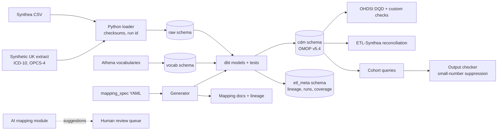

# TraceMap

A documentation-first OMOP CDM v5.4 pipeline with end-to-end provenance.

TraceMap takes synthetic clinical records from two sources, maps them into the OMOP Common Data Model, and keeps every row traceable to the exact line of the exact file it came from. One YAML mapping specification is the source of truth. dbt SQL, dbt tests, documentation pages and lineage diagrams are all generated from it.

**Synthetic data only.** TraceMap never uses, stores or sends real patient data. All records come from Synthea or from the project's own synthetic UK extract generator. See [Five Safes](docs/five_safes.md).

  

---

## Why this exists

Jaden is applying for a Data and Systems Analyst role at Oxford University Hospitals NHS Foundation Trust, working on the Thames Valley and Surrey Secure Data Environment with the Big Data Institute. The TVS SDE's Oxford OMOP Data Mapper uses documentation-first ETL with automatically generated transformation documentation and relationship diagrams. TraceMap is a working, small version of exactly that approach, built to show the hiring panel that the problems and the solutions are already understood.

## Architecture



## Headline numbers

**Build inputs.** Synthea v3.3.0 seed 42 (5,000 patients). UK synthetic extract: 500 patients. Vocabulary: Athena release v5.0 29-AUG-26.

**CDM rows produced.**

| CDM table              |      Rows | Notes                                       |
| ---------------------- | --------: | ------------------------------------------- |
| person                 |     6,307 | 5,807 Synthea + 500 UK                      |
| observation_period     |     5,807 |                                             |
| death                  |       807 |                                             |
| location               |     6,853 | de-duplicated across sources                |
| care_site              |     1,077 |                                             |
| provider               |     1,077 |                                             |
| visit_occurrence       |   433,084 |                                             |
| condition_occurrence   |   235,447 | 230,165 SNOMED + 5,282 UK ICD-10            |
| condition_era          |   205,001 | standard 30-day gap rule                    |
| drug_exposure          |   378,966 |                                             |
| drug_era               |    42,374 |                                             |
| procedure_occurrence   |   862,865 |                                             |
| measurement            | 3,676,459 |                                             |
| observation            | 1,743,754 |                                             |
| cdm_source             |         1 |                                             |
| metadata               |         6 |                                             |

**Quality.** 70 of 70 dbt tests pass. 34 unit tests + 8 integration tests pass. All lint and format checks pass.

**Mapping coverage.**

| Source  | Domain               |      Rows | Row coverage | Code coverage |
|---------|----------------------|----------:|-------------:|--------------:|
| synthea | condition_occurrence |   230,165 |       97.0 % |        45.2 % |
| synthea | drug_exposure        |   378,966 |      100.0 % |       100.0 % |
| synthea | procedure_occurrence |   862,865 |       92.4 % |        44.0 % |
| synthea | measurement          | 3,676,459 |       99.9 % |        97.2 % |
| synthea | observation          | 1,743,754 |       99.9 % |        84.9 % |
| synthea | visit_occurrence     |   433,084 |      100.0 % |       100.0 % |

**AI mapping (350-item gold set, 3 repeated runs).**

| Method       | Top-1 accuracy    | Precision         | Coverage          | Correct abstention |
|--------------|-------------------|-------------------|-------------------|--------------------|
| exact_match  | 39.7 % +/- 0.0 %  | 99.2 % +/- 0.0 %  | 34.3 % +/- 0.0 %  | 100.0 %            |
| bm25         | 80.0 % +/- 0.0 %  | 71.9 % +/- 0.0 %  | 95.4 % +/- 0.0 %  |   2.0 %            |
| hybrid       | 79.7 % +/- 0.0 %  | 71.8 % +/- 0.0 %  | 95.1 % +/- 0.0 %  |   2.0 %            |
| llm_rerank   | 78.0 % +/- 0.0 %  | 71.3 % +/- 0.0 %  | 93.7 % +/- 0.0 %  |   2.0 %            |

Full discussion in [docs/ai_mapping_evaluation.md](docs/ai_mapping_evaluation.md).

## Row-level provenance

```
$ tracemap trace condition_occurrence 100
cdm.condition_occurrence id=100
    condition_occurrence_id = 100
    person_id = 6
    condition_concept_id = 4281516
    condition_start_date = 2017-08-20
    condition_source_value = 66383009
    visit_occurrence_id = 143

Source: raw.synthea_conditions row 100
    run_id       = 5
    file_name    = conditions.csv
    file_sha256  = 57cf421aabb66819...
    file_path    = data/synthea/output/full/csv/conditions.csv

Source row:
    start = 2017-08-20
    stop = 2017-09-03
    patient = 069b5064-ff05-2225-3995-f32685518bc6
    encounter = 66280801-ce08-4198-9dc3-20d205541c23
    system = SNOMED-CT
    code = 66383009
    description = Gingivitis (disorder)
```

Every CDM row carries back to the exact file, line, run and checksum that produced it. See [ADR 0010](docs/decisions/0010-row-lineage.md).

## One-command run

Prerequisites: Docker Desktop, [uv](https://docs.astral.sh/uv/), Java 17, and the OMOP vocabularies downloaded from [Athena](https://athena.ohdsi.org) into `data/vocab/`.

```bash
cp config/settings.example.env .env
make setup                                 # Python environment via uv
make up                                    # Postgres 16 in Docker on port 5440
make db-init                               # schemas + OMOP CDM v5.4 DDL
make vocab-load                            # Athena vocabularies -> vocab schema
uv run tracemap synthea fetch              # jar + SHA-256
uv run tracemap synthea generate --patients 5000 --seed 42
uv run tracemap uk-extract generate --patients 500 --seed 42
uv run tracemap raw load --source synthea --dir data/synthea/output/full/csv
uv run tracemap raw load --source uk_extract --dir data/uk_extract
uv run tracemap generate                   # YAML -> dbt models + docs
cd dbt && dbt run && dbt test && cd ..     # 70 tests, green
uv run tracemap coverage                   # mapping coverage report
uv run tracemap analysis run t2dm_hba1c    # cohort query with safe outputs
uv run tracemap ai gold                    # build 350-item gold set
uv run tracemap ai evaluate --repeats 5    # offline, deterministic
uv run tracemap trace condition_occurrence 100
```

A full `tracemap build` also exists that chains load -> generate -> dbt run -> dbt test -> coverage in one command.

## Documentation

- **[Mapping specifications](docs/mappings/index.md)**: one page per CDM target table, generated from the YAML.
- **[Lineage diagrams](docs/lineage/project.md)**: Mermaid diagrams, generated from the YAML.
- **[Architectural Decision Records](docs/decisions/README.md)**: 13 ADRs covering repo layout, vocab schema, vocabulary loading, verified constants, Synthea version, raw loading and provenance, dbt layout and generator, domain routing (deferred to Phase 2), row lineage, mapping coverage, UK extract and linkage, AI mapping design.
- **[Five Safes](docs/five_safes.md)**: how the design reflects the framework.
- **[Data Quality](docs/data_quality.md)**: dbt tests, custom SQL, OHDSI DQD.
- **[Reconciliation](docs/reconciliation.md)**: ETL-Synthea comparison.
- **[AI mapping evaluation](docs/ai_mapping_evaluation.md)**: full writeup with numbers.

MkDocs site builds with `mkdocs build`.

## What is in scope

**In scope (all built):**

- OMOP CDM v5.4 on PostgreSQL via the official OHDSI DDL.
- Synthea synthetic patients (primary source) and a UK-style synthetic secondary source (ICD-10, OPCS-4), linked by HMAC-SHA256.
- Documentation-first mapping specification; generator produces dbt SQL, dbt tests and mapping docs; MkDocs site.
- Row-level provenance with `tracemap trace`.
- Data quality: dbt tests, custom checks, OHDSI DQD runner.
- Reconciliation framework against OHDSI ETL-Synthea.
- Cohort queries with output checking (small-number suppression).
- AI-assisted mapping evaluation module: baselines, constrained LLM re-ranker, verified safety gate, repeated runs.
- GitHub Actions CI with fixture vocabulary.

**Non-goals (stated plainly):**

- No real patient data.
- No claim of clinical validity. Synthea is synthetic and US-centric. The UK extract is derived from Synthea.
- Not a production SDE. No access control, no real TRE infrastructure.
- Not a replacement for OHDSI tools; TraceMap uses them for validation (DQD, ETL-Synthea).

## Honest limitations

- **Domain routing** is proposed but not yet enabled (see [ADR 0009](docs/decisions/0009-domain-routing.md)). Phase 1 coverage numbers mildly understate correctness.
- **OHDSI DQD and ETL-Synthea** are R-based; the scripts and documented run procedure are committed, but automated runs need an R + Java environment outside this Python repo.
- **UK extract** is derived from Synthea's SNOMED to UK coding systems via Athena concept relationships; it is not a direct simulation of an NHS extract.
- **LLM re-ranker** runs offline and deterministically by default; the Anthropic backend is wired but gated on `ANTHROPIC_API_KEY`.

## Repository layout

```
tracemap/
  mapping_spec/               # 14 YAML files, the source of truth
  src/tracemap/               # Python package
    cli.py                    # typer: db, vocab, synthea, uk-extract, raw, spec,
                              #        generate, trace, coverage, analysis, ai, build
    config.py, db.py, constants.py
    load/                     # ddl + raw CSV loader
    spec/                     # pydantic models for mapping YAML
    generate/                 # YAML -> dbt sql, dbt tests, markdown docs, mermaid
    lineage/                  # tracemap trace
    quality/                  # mapping coverage
    outputs/                  # small-number suppression
    sources/                  # UK synthetic extract generator
    ai_mapping/               # gold set, baselines, LLM re-ranker, evaluation
    synthea.py                # Synthea jar fetcher and runner
  dbt/
    dbt_project.yml, profiles.yml, sources.yml
    models/staging/           # per-source staging views
    models/intermediate/      # key maps, vocab plumbing, location dedup
    models/cdm/               # 14 generated models + era tables
    macros/                   # generate_schema_name, normalise_icd10, normalise_opcs4
  ddl/                        # official OHDSI CDM v5.4 + TraceMap etl_meta tables
  analysis/                   # 3 cohort queries
  r/                          # run_dqd.R, run_etl_synthea.R
  docs/
    index.md, five_safes.md, data_quality.md, reconciliation.md, ai_mapping_evaluation.md
    mappings/, lineage/       # generated
    decisions/                # 13 ADRs
  tests/
    unit/                     # 34 tests
    integration/              # tracemap_test DB, 8 tests + idempotence
    fixtures/vocab/           # tiny fake vocabulary for CI
  mkdocs.yml, .github/workflows/ci.yml, docker-compose.yml, Makefile
  pyproject.toml, uv.lock
```

## License and attribution

MIT. OMOP CDM is an OHDSI standard; see [https://ohdsi.github.io/CommonDataModel/](https://ohdsi.github.io/CommonDataModel/). Synthea is open source: [https://github.com/synthetichealth/synthea](https://github.com/synthetichealth/synthea). The Athena vocabularies are licensed for download and are never committed to this repository.
