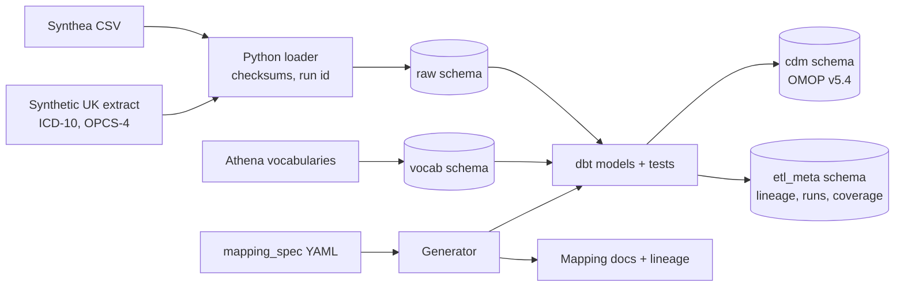

# TraceMap

A documentation-first OMOP CDM v5.4 pipeline with end-to-end provenance.

TraceMap takes synthetic clinical records from two sources, maps them into the OMOP Common Data Model, and keeps every row traceable to the exact line of the exact file it came from. One YAML mapping specification is the source of truth. dbt SQL, dbt tests, documentation and lineage diagrams are all generated from it.

**Synthetic data only.** TraceMap never uses, stores or sends real patient data. All records come from Synthea or from the project's own synthetic UK extract generator.

---

## Architecture



## Phase 1 headline numbers

5,000 synthetic patients, Synthea v3.3.0 seed 42, vocabulary release v5.0 29-AUG-26:

| CDM table              |      Rows | Mapping |
| ---------------------- | --------: | ------: |
| person                 |     5,807 |  100.0% |
| observation_period     |     5,807 |       - |
| death                  |       807 |       - |
| location               |     6,853 |       - |
| care_site              |     1,077 |       - |
| provider               |     1,077 |       - |
| visit_occurrence       |   433,084 |  100.0% |
| condition_occurrence   |   230,165 |   97.0% |
| drug_exposure          |   378,966 |  100.0% |
| procedure_occurrence   |   862,865 |   92.4% |
| measurement            | 3,676,459 |  100.0% |
| observation            | 1,743,754 |   99.9% |

Totals: **14.6 M** source rows across 18 CSVs, **7.3 M** CDM rows, **70/70** dbt tests passing.

## Row-level provenance

```
$ tracemap trace condition_occurrence 100
cdm.condition_occurrence id=100
    condition_occurrence_id = 100
    person_id = 6
    condition_concept_id = 4281516
    condition_start_date = 2017-08-20
    condition_source_value = 66383009
    visit_occurrence_id = 143

Source: raw.synthea_conditions row 100
    run_id       = 5
    file_name    = conditions.csv
    file_sha256  = 57cf421aabb66819...
    file_path    = data/synthea/output/full/csv/conditions.csv

Source row:
    start = 2017-08-20
    stop = 2017-09-03
    patient = 069b5064-ff05-2225-3995-f32685518bc6
    encounter = 66280801-ce08-4198-9dc3-20d205541c23
    system = SNOMED-CT
    code = 66383009
    description = Gingivitis (disorder)
```

Every CDM row carries back to the exact file, line, run and checksum that produced it.

## Running from a clean clone

Prerequisites: Docker Desktop, [uv](https://docs.astral.sh/uv/), Java 17 (for Synthea), and the OMOP vocabularies downloaded from [Athena](https://athena.ohdsi.org) into `data/vocab/`.

```bash
cp config/settings.example.env .env
make setup                       # Python environment via uv
make up                          # Postgres 16 in Docker on port 5440
make db-init                     # schemas + OMOP CDM v5.4 DDL
make vocab-load                  # Athena vocabularies -> vocab schema
uv run tracemap synthea fetch    # jar + SHA-256
uv run tracemap synthea generate --patients 5000 --seed 42
uv run tracemap build            # raw load -> generate -> dbt run/test -> coverage
uv run tracemap trace condition_occurrence 100
```

`make`-less equivalents: every step is also a `uv run tracemap ...` command. The project runs on Windows, macOS and Linux unchanged.

## Documentation

- [Architectural Decision Records](docs/decisions/README.md): every design choice, in plain English, with alternatives.

## Honest limitations

- **Synthetic data only.** Synthea is US-centric and does not reflect UK clinical practice.
- **Phase 1 only.** Domain routing is proposed but not enabled (ADR 0009). Multi-source + ICD-10/OPCS-4 extract, OHDSI DQD, ETL-Synthea reconciliation, cohort queries with output checking, and AI mapping are Phase 2 and 3.
- **No production safeguards.** This is a portfolio project, not an SDE. No access control, no real TRE infrastructure. The design reflects Five Safes principles but a real SDE deployment would add to them.
- **Vocabulary files are licensed** and are never committed. They have to be downloaded separately from Athena.
